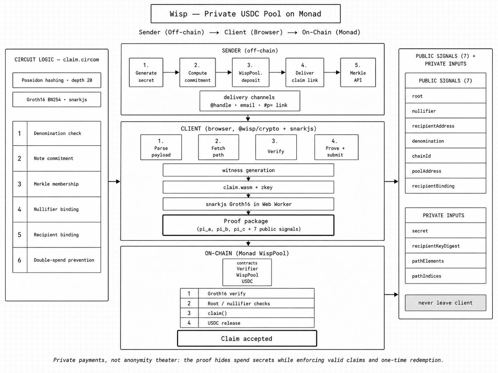

[Live demo](https://wisp-monad.vercel.app/) · [Demo video](#) · [Super Launch I](#)

## Problem

Wisp began after a simple payment between friends turned into an awkward exchange of wallet addresses, network checks, and screenshots—only to leave both wallets and their histories publicly connected forever. We wondered why sending crypto could not feel as natural as sending a message: choose a person, enter an amount, and let them claim it privately.

## Solution

So we built Wisp, where anyone can send USDC to an `@handle` or email. The recipient receives a private inbox note or claim link, while settlement is protected by client-side zero-knowledge proofs on Monad.

---

## Deployments

| Resource | Value |
| -------- | ----- |
| Frontend | [wisp-monad.vercel.app](https://wisp-monad.vercel.app/) — `/` · `/send` · `/inbox` · `/claim` · `/c#p=…` |
| API | [wisp-monad-api.onrender.com](https://wisp-monad-api.onrender.com) |
| Network | Monad Testnet (`chainId` `10143`) |
| RPC | `https://testnet-rpc.monad.xyz` |
| Explorer | [testnet.monadvision.com](https://testnet.monadvision.com) |
| Groth16 Verifier | [`0x1026346d75D10FEa3340361DC6C288E25DB46C3A`](https://testnet.monadvision.com/address/0x1026346d75D10FEa3340361DC6C288E25DB46C3A) |
| Poseidon T3 | [`0xbAb52Fb2e83C250D7f9e86eEa76E8D49D63C79c3`](https://testnet.monadvision.com/address/0xbAb52Fb2e83C250D7f9e86eEa76E8D49D63C79c3) |
| Circle USDC | [`0x534b2f3A21130d7a60830c2Df862319e593943A3`](https://testnet.monadvision.com/address/0x534b2f3A21130d7a60830c2Df862319e593943A3) |
| Pool (1 USDC) | [`0x919B3eF692eCD2F14d3402Cfe0015E4D7d8D9d3d`](https://testnet.monadvision.com/address/0x919B3eF692eCD2F14d3402Cfe0015E4D7d8D9d3d) |
| Pool (10 USDC) | [`0x3B69E0B1A5Ea9Ab53B474ee087a71B48377D700c`](https://testnet.monadvision.com/address/0x3B69E0B1A5Ea9Ab53B474ee087a71B48377D700c) |
| Pool (50 USDC) | [`0xb3f5cEC6b9D4462756477c1268E01C8525C6Dc8c`](https://testnet.monadvision.com/address/0xb3f5cEC6b9D4462756477c1268E01C8525C6Dc8c) |
| Pool (100 USDC) | [`0xe50Ae387881943c7e4149cEF0873cf4D5F37fFD0`](https://testnet.monadvision.com/address/0xe50Ae387881943c7e4149cEF0873cf4D5F37fFD0) |
| Circuit ID | `0xb615da4b4eb2693502e7da531e51e7450572c8c2083105ef2f5898b38ad38745` |
| Deploy block | `44778621` |

Manifest → [`deployments/10143.json`](deployments/10143.json) · redeploy [`scripts/deploy/monad-testnet.sh`](scripts/deploy/monad-testnet.sh) · config [`.env.example`](.env.example) · ops [`docs/DEPLOYMENT.md`](docs/DEPLOYMENT.md)

---

## Workspace

| Package / app | Purpose |
| ------------- | ------- |
| [`apps/web`](apps/web) | Next.js 15 frontend — send, claim, inbox, register, account |
| [`apps/api`](apps/api) | Fastify API + durable Monad indexer (Render) |
| [`contracts`](contracts) | Foundry — `WispPool`, Groth16 verifier, Poseidon T3, Mock USDC |
| [`circuits`](circuits) | Circom claim + viability circuits, ceremony artifacts |
| [`packages/crypto`](packages/crypto) | Poseidon, encryption, proof helpers |
| [`packages/shared`](packages/shared) | Protocol constants, deployment manifest, claim links |

---

## Core Architecture

```
Sender (browser)
  → resolve @handle / email via API
  → deposit USDC into fixed-denomination WispPool (commitment on-chain)
  → deliver encrypted note to registered inbox, email invite, or bearer claim link
Recipient (browser)
  → unlock inbox / open claim link
  → witness (@wisp/crypto) → Groth16 in Web Worker (7 public inputs)
  → claim() on WispPool — verifier + nullifier + USDC transfer
```

```
apps/web (Next.js)
  ↓
@wisp/shared          constants · deployment manifest · claim-link encoding
@wisp/crypto          Poseidon · encryption · proof helpers
  ↓
apps/api (Fastify)    handles · notes · invites · merkle cache · activity
  ↓
Supabase              auth (Google / X / email) · Postgres · indexer cursors
Upstash Redis         rate limits
Resend                email claim links
  ↓
Monad Testnet         WispPool × 4 denoms · Groth16 verifier · Poseidon T3
```

```
wisp-monad/
├── apps/
│   ├── web/             Next.js frontend (Vercel)
│   └── api/             Fastify API + indexer (Render)
├── contracts/           Foundry pools, verifier, Poseidon
├── circuits/            Circom circuits + ceremony artifacts
├── packages/
│   ├── crypto/          ZK + encryption primitives
│   └── shared/          protocol types + deployment manifest
├── deployments/         checked-in Monad Testnet manifest
├── supabase/migrations/ Postgres schema
└── scripts/             dev · deploy · e2e smoke
```

---

## ZK Implementation

**Stack:** Groth16 · BN254 · Poseidon t=3 · 20-level Merkle tree · **7 public inputs**



Public signal order (locked): `root`, `nullifier`, `recipientAddress`, `denomination`, `chainId`, `poolAddress`, `recipientBinding` — see [`circuits/src/claim.circom`](circuits/src/claim.circom).

---

## Key Features

- **Handle-first payments** — send to `@handle` or email; no wallet address hunt at checkout
- **Fixed-denomination note pools** — 1 / 10 / 50 / 100 USDC pools with on-chain Poseidon Merkle trees
- **Client-side Groth16 claiming** — proof generation in a Web Worker; secret never leaves the browser
- **Registered inbox** — encrypted note delivery; backend stores ciphertext only
- **Unregistered delivery** — bearer claim links (`/c#p=…`) and optional Resend email invites
- **Hybrid identity** — Supabase auth (Google, X, email) + linked Monad wallet for settlement
- **Durable indexer** — Merkle cache, activity feed, and invite status rebuilt from finalized logs
- **OpenAPI contract** — [`apps/api/openapi.json`](apps/api/openapi.json) drives typed frontend clients

---

## Tech Stack

| Layer | Stack |
| ----- | ----- |
| Frontend | Next.js 15, React 19, Tailwind 4, framer-motion, wagmi/viem |
| API | Fastify 5, Zod, OpenAPI, Pino |
| Contracts | Foundry, OpenZeppelin, Solidity 0.8.28 |
| ZK | Circom 2.1.6, snarkjs, Groth16, BN254, Poseidon |
| Data | Supabase (Postgres + Auth), Upstash Redis |
| Email | Resend |
| Settlement | Monad Testnet · Circle USDC · `WispPool` |
| Design | Onest · Restrained Cobalt · `#2C5CC5` · `#171A20` |

---

## Local Development

**Prerequisites:** Node 22+ · pnpm 10+ · Foundry · circom 2.1.6 · snarkjs 0.7+ · Supabase project · Upstash Redis (optional locally)

| Command | Description |
| ------- | ----------- |
| `pnpm dev` | Web + API + indexer (see [`scripts/dev.sh`](scripts/dev.sh)) |
| `pnpm dev:web` | Next.js dev server (`localhost:3000`) |
| `pnpm dev:api` | Fastify API (`localhost:8787`) |
| `pnpm dev:indexer` | Monad log indexer |
| `pnpm build:circuits` | Compile Circom + export verifier |
| `pnpm test:contracts` | Foundry test suite |
| `pnpm test:circuits` | Circuit regression tests |
| `pnpm smoke:phase2` | API smoke against running backend |
| `pnpm smoke:phase3` | Frontend smoke |
| `pnpm deploy:testnet` | Redeploy contracts to Monad Testnet |
| `pnpm check` | lint · typecheck · test · build |

Copy [`.env.example`](.env.example) → `.env` and follow [`docs/ENV_SETUP.md`](docs/ENV_SETUP.md).

---

## Env Setup

Shared credentials live in the repo-root `.env` (gitignored). Production sync:

```bash
pnpm deploy:env -- \
  --web-origin https://wisp-monad.vercel.app \
  --create-render \
  --deploy
```

**Web** — public vars:

```bash
NEXT_PUBLIC_MONAD_RPC_URL=https://testnet-rpc.monad.xyz
NEXT_PUBLIC_API_URL=https://wisp-monad-api.onrender.com
NEXT_PUBLIC_SUPABASE_URL=
NEXT_PUBLIC_SUPABASE_ANON_KEY=
NEXT_PUBLIC_WALLETCONNECT_PROJECT_ID=
```

**API** — key vars:

```bash
SUPABASE_URL=
SUPABASE_SERVICE_ROLE_KEY=
REDIS_URL=
REDIS_TOKEN=
RESEND_API_KEY=
RESEND_FROM_EMAIL=
MONAD_INDEXER_RPC_URL=https://testnet-rpc.monad.xyz
CORS_ALLOWED_ORIGINS=https://wisp-monad.vercel.app
API_ORIGIN=https://wisp-monad-api.onrender.com
CLAIM_PAYLOAD_ENC_KEYS_JSON={"1":"<32-byte-hex>"}
INVITE_STATUS_HMAC_KEYS_JSON={"1":"<32-byte-hex>"}
RUN_INDEXER=true          # Render only; false locally
```

Full walkthrough: [`docs/ENV_SETUP.md`](docs/ENV_SETUP.md) · production topology: [`docs/DEPLOYMENT.md`](docs/DEPLOYMENT.md)

---

## Trust & Security

- **Private payments, honest limits** — amounts are fixed denominations, not hidden balances; testnet anonymity set is small
- **Encrypted registered delivery** — note secrets encrypted to recipient keys; API stores ciphertext only
- **Client-side nullifier** — nullifier derived locally inside the claim circuit witness
- **On-chain anti-replay** — nullifier hash recorded per claim; duplicate proofs rejected
- **Bearer claim links** — unregistered recipients rely on link secrecy; email delivery trusts Resend
- **Claim tx visibility** — claim transaction sender pays MON gas and is visible on-chain
- **Not production-ready** — unaudited hackathon code; move indexer off Render Free before real use

Runbooks: [`docs/DEPLOYMENT.md`](docs/DEPLOYMENT.md) · [`apps/api/OPS.md`](apps/api/OPS.md) · [`scripts/deploy/`](scripts/deploy/)

---

## Super Launch Trailer

Watch the Wisp Super Launch trailer:

<!-- Replace # with the YouTube URL when available -->
<a href="#" aria-label="Watch the Wisp Super Launch trailer on YouTube">
  
</a>
